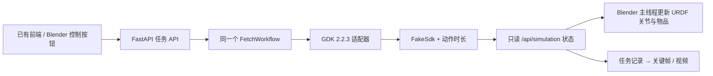

# Blender 与 GDK 指令联动

本机已安装官方 Blender **4.5.15 LTS（Apple Silicon）**，路径：
`~/Applications/Blender-4.5.app`。安装包来源为 Blender 官方发布目录，下载后已核对官方 SHA-256。

机器人使用智元官方 [genie_sim_robot_model](https://github.com/AgibotTech/genie_sim_robot_model) 的 **Genie G2 / crsB / swiftpicker** URDF 和网格，固定提交 `6d5b2159806ae0e64b432b638e9ee288d8bddc8f`。上游 LICENSE、THIRD_PARTY_NOTICES 和来源记录保留在 `simulation/assets/agibot_g2/`。没有修改上游资产；本项目增加了展台、货架、商品和示意接物人。

## 直接体验

项目根目录运行：

```bash
bash scripts/start-blender-demo.sh
```

脚本在独立端口 **8001** 启动或复用 GDK 模拟后端，并打开 Blender。原来的 8000 后端不受影响。

1. 打开 <http://127.0.0.1:8001>，输入“帮我拿奥利奥”。
2. 网页自动进入「取物 Agent · 方案演示」。左侧对话和任务计划，右侧显示 Agent、感知 SDK、GDK 和接物反馈的调用记录；点击任意记录查看参数、返回和动作反馈，也可按类别筛选。
3. 在 Blender 看机器人导航、精停、扫描、横移、抓取、返回和交接。右侧同步显示 Agent 当前计划、最新 SDK 调用与返回；底部显示底盘位置和任务进度。
4. 到递物阶段，在网页点击 **我已接稳物品**，机器人收到模拟支撑信号后松爪。点 **复位** 可以再次演示。
5. 也可在 Blender 按 `Ctrl+Space` / `Ctrl+Alt+Space` 退出当前区域的展示布局后，按 `N` 打开 **兰剑联动** 控制栏。正常讲解直接使用网页即可。
6. **停止任务** 会中止任务，并把可视化冻结在当前动作位置；异常后可点 **复位模拟器**。

启动脚本默认使用 **手动接物**，最长等待 180 秒，留出现场讲解时间。无人操作的自动演示可用另一端口启动：

```bash
BLUESWORD_SIM_PORT=8002 BLUESWORD_AUTO_TAKE=true bash scripts/start-blender-demo.sh
```

自动模式到达递物姿态后 2 秒产生模拟信号。未到递物阶段时，提前确认会被拒绝；等待超时会保持夹爪。服务器启动时读取环境变量；脚本复用已有服务时不会改变其配置。

## 给同事讲解的顺序

1. **用户给目标**：“帮我拿奥利奥”。Agent 将请求编排成导航、感知、抓取和交接步骤。当前 Agent 为规则示意，大模型以后接入。
2. **感知 SDK 给目标位置**：`PerceptionSDK.detect_objects(rgbd, target)` 返回目标框和置信度；`PerceptionSDK.estimate_grasp_pose(rgbd, detection)` 返回 `base_link` 坐标系下的米制位置、四元数 `xyzw` 和预抓取偏移。这两个是拟定接口，不是智元 GDK 的函数。实现位于 `backend/bluesword/demo_perception.py`，当前为占位示例。
3. **Agent 选择下一步**：目标超出横向可达范围时调用 `Pnc.relative_move()`；横移后重新采集和计算，避免复用旧坐标。
4. **GDK 执行动作**：展示 `normal_navi()`、`high_precision_navi()`、`end_effector_pose_control()`、`move_ee_pos()`。接口返回与动作完成反馈分别展示，返回成功不代表已到位。请求参数以适配器审计摘要展示，不是完整 SDK 二进制消息；`null` 表示模拟函数无直接返回值。
5. **人确认交接**：网页“我已接稳物品”模拟未来接物传感器的反馈。Agent 等待反馈后才发松爪指令。可顺便演示停止和复位。

网页与 Blender 读取同一份 `/api/simulation` 状态和 trace，调用记录来自本次执行。停止时进行中的记录会标记为取消，复位或新任务会开始新的记录。Blender 右侧面板是实时视口覆盖层，旧 MP4 和离线烘焙动画不包含这层交互展示。

Blender 的连接只读取状态；关闭 Blender 不会向后端发送完成信号，也不会终止 HTTP 发起的任务。后端停止或连接中断时，画面保持并显示连接异常。前端 WebSocket 发起的任务仍遵循原有“控制连接断开则取消”规则。

## 已生成的演示文件

- `output/blender/lanjian_gdk.blend`：实时场景。
- `output/blender/lanjian_gdk_animation.blend`：完整任务的关键帧动画。
- `output/blender/lanjian_fetch_demo.mp4`：约 27 秒演示视频。
- `output/blender/demo.json`：从后端实际任务采集的时间戳、指令、位置与步骤状态。
- `output/blender/{preview,navigation,scan,grasp,handover,complete}.png`：阶段预览。

离线回放（不连接后端）：

```bash
bash scripts/start-blender-demo.sh --replay
```

在 Blender 按空格播放。启动脚本会恢复随帧变化的字幕；直接双击动画 `.blend` 仍可播放几何动画，但字幕不会自动更新。未开启 Blender 的自动运行脚本权限。

## 工作方式



新增 `BLUESWORD_ROBOT_MODE=gdk_mock`，和 `mock` / `gdk` 模式隔离。使用官方 `NaviReq`、末端位姿、夹爪等请求形状的模拟 SDK；每次指令推进对应动作时长，现有任务状态机继续检查完成反馈。`BLUESWORD_SIMULATION_SPEED` 可设为 0.25–30，默认为 1。

Blender 约每 40 ms 在后台线程读取状态，所有 `bpy` 变更都在主线程 timer 中执行。关节视觉姿态由 URDF 正运动学及显示用 IK 计算，遵守模型关节限位。夹爪闭合成功后物品随手移动，松爪后留在接物人手边。演示商品位于右臂一侧，场景点位为合成配置。

**这是指令和运动学可视化。** G2 的公开模型未与展会实机逐项核对；动作时长、抓取接触、RGB-D 图像和接物信号仍由模拟器产生。显示用 IK 不回写 GDK，不验证碰撞、动力学、相机识别成功率或真实接物力。末端目标位置和模型关节可视化之间的误差会写入动画文件的 `max_display_ik_error_m` 属性。需要物理闭环时可在此接口后继续接 Genie Sim / Isaac Sim 等环境。

## 重建与验证

```bash
# 重新获取固定版本资产，并校验 Git blob 哈希
uv run --project backend python simulation/fetch_assets.py
uv run --project backend --with xacro python simulation/prepare_model.py

# 生成场景（Linux 可将此路径替换为 blender）
BLENDER_BIN="$HOME/Applications/Blender-4.5.app/Contents/MacOS/Blender"
"$BLENDER_BIN" -b --factory-startup --python simulation/build_scene.py

# 后端 8001 空闲时执行一次任务并记录
python3 simulation/record_demo.py

# 烘焙动画、渲染阶段图；加 -- --render 改为导出视频
"$BLENDER_BIN" -b output/blender/lanjian_gdk.blend --python simulation/bake_demo.py
"$BLENDER_BIN" -b output/blender/lanjian_gdk.blend --python simulation/bake_demo.py -- --render

cd backend
uv run --extra dev pytest -q
```

当前自动测试覆盖联动完整任务、实际 SDK 请求审计、半程取消后冻结、模拟器复位、手动接物及接口模式隔离。渲染检查覆盖导航、扫描、抓取、交接和完成阶段。
